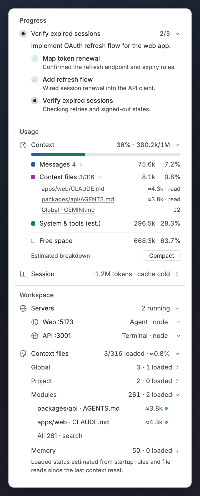

> **English** | [简体中文](README.zh-CN.md)

# Session Cockpit

See thread progress, context usage, and what’s running in your workspace from one card in [BB](https://getbb.app).



_Demo labels and paths in the live BB interface._

## What you can see

| Group | At a glance |
| --- | --- |
| **Environment** | Shows the project name. Expand it for the repository, the environment kind (Worktree, Project checkout, Personal workspace), the branch with a green dot when clean or an orange `M` and the changed-file count from bb's git plugin, the path with a one-click copy, and **New thread in this environment**. Non-git workspaces show only the kind and path. |
| **Progress** | See the current stage and how many are done. Expand the row for the briefing and stage notes from the optional [Worktree Lineage](#related-bb-plugins) plugin. The summary, stage titles and notes are always shown as written, the same briefing as Worktree Lineage's hover card. **Regenerate** at the bottom rewrites it now in the Progress row's language, and changing the Progress row's language in settings also switches the briefing generation language. |
| **Usage** | See how full the context window is, what’s using it, and when the prompt cache might expire. The **Session** row adds token totals, cache hits, working time, and cost when the provider reports it. |
| **Workspace** | See which context files are loaded and which dev servers are running. Preview a file, open a server, run a project script, see loaded MCP connectors, or open a side chat. |

**Context files update as the agent works.** A readout like `3/316 loaded · ≈0.8%` shows the number of loaded files out of the scanned inventory and their estimated share of the entire context window. Expand a group to see the files, then click a file to preview it. The panel marks observed reads and distinguishes estimated sizes from provider-reported values.

**Context breakdowns work across providers.** Claude Code’s official snapshots keep their published values. For providers such as Codex and Antigravity that report a total only, the card shows an **Estimated breakdown** whose used categories add up to the reported total.

**Same details on phones and narrow panes.** Open the session banner above the composer when the desktop card doesn’t fit. On desktop, optional interface polish smooths card transitions, keeps the prompt navigator accessible, and adjusts pointer behavior. **Choose details** in plugin settings controls which rows appear, their order, and each row’s language.

**Session Cockpit does not read or watch private local JSONL session logs.** Usage comes from BB’s APIs and events. File inventory and server discovery run on the workspace host.

<details>
<summary>Context usage, estimates, and cache timing</summary>

- **Official snapshots.** The Context meter uses the provider’s used categories, free space, and any reported autocompact reserve. Observed file reads can appear alongside Claude Code’s Memory files with a `read` label and an estimated size. They do not change the official category values. Workspace percentages cover the scanned inventory and can differ from the official Memory files percentage.
- **Messages.** The estimate uses up to 300 recent relevant BB events and stops at a compaction or clear. Accepted user input, completed assistant messages, tool arguments, and visible results use roughly one token per four UTF-8 bytes. Images use a placeholder of 256 tokens each. File attachments count by reference. Tool results attributed to context files are deducted from this category.
- **Context files.** Codex starts with matching global and project-root `AGENTS.md` files, preferring `AGENTS.override.md` where available. Antigravity uses matching `GEMINI.md` files. The plugin adds matched successful reads from the current context, deduplicates paths, and estimates one token per four file bytes.
- **Residual and free space.** System & tools (est.) is the reported usage left after assigning messages and files. That remainder can include earlier history, compacted summaries, and hidden instructions. If the estimates run over the budget, the plugin scales and rounds the child entries so used categories still sum to the reported usage. Free space is window size minus reported usage, floored at zero.
- **Session and cache.** Session totals come from `thread/tokenUsage/updated`. The plugin normalizes providers that include or exclude cached input in their totals. Cache warmth uses the latest usage timestamp and the provider’s TTL. The elapsed working time covers up to roughly 250 recent turns.
- **Compaction.** The card warns as usage reaches the configured threshold (80% by default). Compact requires two clicks within three seconds. The observed-read count resets when BB reports a compaction or clear.

</details>

<details>
<summary>How the seven context file levels are scanned</summary>

| Level | What the scan looks for |
| --- | --- |
| Global | `~/.claude/CLAUDE.md`, `~/.codex/AGENTS.md`, and `~/.gemini/GEMINI.md`. |
| Parent | Matching instruction files in up to 12 ancestor directories, stopping at the home directory when applicable. |
| Project | Root `CLAUDE.md`, `AGENTS.md`, `AGENTS.override.md`, `GEMINI.md`, and `.claude/CLAUDE.md`. |
| Modules | `CLAUDE.md`, `AGENTS.md`, and `GEMINI.md` in subdirectories. Git workspaces respect ignore rules. Other workspaces use a bounded directory walk. |
| Local | `CLAUDE.local.md` in the workspace. |
| Rules | Markdown files directly under `.claude/rules/` or `~/.claude/rules/`. |
| Memory | Markdown files under the project’s Claude auto-memory directory or `.claude/memory/`. |

A green dot marks a loaded file. A small `M` marks workspace changes, including untracked files. A successful file-read event, a recognized read tool, or a simple single-file `cat` can record an observed read. The scan uses file metadata for modules and memory. Resolvable `@path` imports in Global, Parent, Project, Local, and Rules appear beneath their source file and stay out of the file count.

When a level exceeds the inline list limit (eight files by default), the inline list prioritizes the memory index, loaded files, and changed files. Use **All N · search** to filter the full list by path. The expanded Workspace item rechecks disk changes every 30 seconds while visible.

</details>

<details>
<summary>Dev servers, scripts, and other workspace tools</summary>

On macOS and Linux, the workspace host uses `lsof -iTCP -sTCP:LISTEN` to discover listeners and checks process working directories and ancestry. It distinguishes agent CLI ports, agent child processes, BB terminal processes, Docker Compose services, and other processes. Inherited `BB_THREAD_ID` values let it distinguish agent-owned services across threads in one workspace. Terminal and Compose services are workspace-scoped. Discovery draws on Hotspot and Worktree Ports, both MIT-licensed.

Agent CLI ports are excluded from HTTP probing and stop actions. Current-thread and workspace services appear first, with agent and other-thread ports grouped separately. Click an HTTP service to open it. **Stop** requires confirmation and a fresh ownership check to guard against PID reuse. Server discovery refreshes every 30 seconds while the row is open and visible. A short scan cache and a 60-second HTTP probe cache reduce repeated work.

Give a port a human-readable name with `.bb/ports.json`:

```json
{"ports":[{"port":5173,"label":"Web","scheme":"http"}]}
```

Project scripts run in the thread’s terminal. An optional preview URL opens after launch. Connectors reflect MCP tools reported in the context breakdown. Side chats open in a split pane and can be renamed from their row menu.

</details>

<details>
<summary>Interface details and theme compatibility</summary>

Rows start collapsed and remember their open state in the browser. Long lists show a short inline preview and a searchable dialog. On touch screens, tap targets are 36 px tall and dialogs open as bottom sheets. Desktop card motion gives the transcript room, keeps the card in place when switching threads, and keeps the prompt navigator accessible. The card scrolls internally up to its configured maximum height (864 px by default).

Some BB themes scale buttons on press. Cockpit rows use `active:scale-100` and a background change for stable press feedback. Desktop pointer polish preserves the text-selection cursor in the transcript and the hand cursor on links. The plugin respects reduced-motion preferences. Both polish options can be disabled independently. Settings show the results of the built-in checks for host UI changes after BB upgrades.

</details>

## Install

```sh
git clone https://github.com/waiclay-349687/bb-plugin-session-cockpit.git
cd bb-plugin-session-cockpit
npm install --include=dev
bb plugin build .
bb plugin install "path:$PWD" --yes
```

Use BB 0.49 or newer and Node.js 22 or newer. Enable and pin BB’s experimental **Thread context card** for the desktop layout:

```sh
bb settings experiment threadContextCard true
bb settings ui set threadContextCard.pinned true
```

The session banner is available on phones and narrow panes. Install [Worktree Lineage](#related-bb-plugins) for the optional Progress briefing.

### Language

Choose **Language** in the plugin settings. `auto` follows BB’s interface language, then the browser when BB has no language set. Chinese locales use Simplified Chinese. Choose `en` for English or `zh` for Simplified Chinese. Changes apply to open cockpit panels immediately. When a saved briefing uses a different language, the panel shows localized stage numbers and statuses.

```sh
bb plugin config session-cockpit set language zh
```

### Customize the cockpit

Open **Tools → Session Cockpit**. In **Choose details**, drag rows or use the up/down buttons to arrange all nine sections. Use the checkboxes to hide rows and the language menus to override the plugin language for individual sections. The desktop card and phone banner use the same browser preferences. Each panel has its own reset.

**Display options** exposes the context warning threshold (50–95%, default 80%), inline list limit (4–20 rows, default 8), and desktop card height (480–1200 px, default 864 px).

**Progress briefing** edits the shared Worktree Lineage settings when that plugin supports configuration. Set the generation language, gateway URL and model chain, fallback model, system prompt, and daily limit. You can copy the default prompt into the editor, restore it, reset today’s count, or clear cooldowns. If the Progress row uses a different language, the panel offers to match it before saving.

## Agent CLI

```sh
bb session-cockpit summary [--thread <id>] [--json]
bb session-cockpit servers [--thread <id>] [--json]
```

Inside a BB thread, omit `--thread` to use the current thread. The CLI skill describes the output. [Agent CLI reference](skills/session-cockpit/SKILL.md)

## Develop

```sh
npm run check
bb plugin reload session-cockpit
```

The check runs TypeScript, the Node.js test suite, and the plugin build. After reloading, press **⌘R** in an open BB window to load the new frontend bundle.

## Related BB Plugins

- **bb-plugin-worktree-lineage** — Worktree & branch-lineage sidebar thread list with smooth motion, Settled shelf, attention-jump shortcuts, and hover briefings. [Repository](https://github.com/waiclay-349687/bb-plugin-worktree-lineage)
- **bb-plugin-session-cockpit** (this plugin) — Progress, context usage, and workspace tools in the thread card. [Repository](https://github.com/waiclay-349687/bb-plugin-session-cockpit)
- **bb-plugin-usage-rings** — Bottom-left sidebar usage rings with pace tracking across providers including Antigravity. [Repository](https://github.com/waiclay-349687/bb-plugin-usage-rings)

## License

MIT, see [LICENSE](LICENSE).
