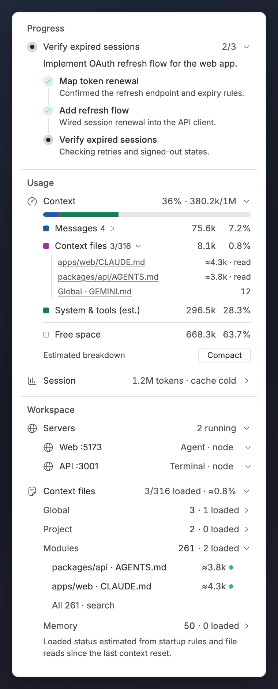

> [English](README.md) | **简体中文**

# Session Cockpit 会话驾驶舱

在 [BB](https://getbb.app) 的对话卡片里，一眼看到任务做到哪了、上下文还剩多少、工作区跑着哪些服务。



_截图来自 BB 实际界面，阶段和路径使用演示数据。_

## 一眼能看到什么

| 分组 | 能看到什么 |
| --- | --- |
| **Environment · 环境** | 收起时显示项目名。点开看仓库、环境类型（工作树 / 项目目录 / 个人工作区）、分支及 bb git 插件给出的状态（无改动是绿点，有改动是橙色 `M` 加改动文件数）、可一键复制的路径，以及「在此环境新建线程」。非 git 工作区只显示类型和路径。 |
| **Progress · 进度** | 看当前做到哪一步、已经做完几步。点开能看每一步的简短说明，需要安装可选的 [Worktree Lineage](#同系列-bb-插件)。底部的 **重新生成** 会按当前设置立即重写总结。 |
| **Usage · 用量** | 彩色分段条告诉你上下文用掉多少、分别用在哪。**Session** 还能看缓存冷热、命中率、token 总数、工作时长，以及服务商提供的费用。 |
| **Workspace · 工作区** | 看哪些说明文件已加载、哪些开发服务在跑。可以点开预览文件、打开服务、跑项目脚本，也能查看已加载的 MCP 连接器和打开旁支对话。 |

**上下文文件随对话实时更新。** 比如 `3/316 loaded · ≈0.8%` 表示扫描到 316 份说明文件，其中 3 份计为已加载，约占整个上下文窗口的 0.8%。点开一层能看具体文件。界面会标出观测到的读取和估算值。

**不同模型都有上下文明细。** Claude Code 保留官方读数。Codex、Antigravity 等只上报总量时，会显示带 **Estimated breakdown（估算明细）** 标记的分段条。所有已用分类加起来等于上报总量。

**手机和窄窗口也能看。** 桌面卡片放不下时，点输入框上方的会话横幅就能展开相同的内容。桌面还有可选的界面修饰，让卡片切换更平滑、历史提问导航不被挡住，鼠标指针也更一致。在插件设置的**显示分区**里，可以选择要看的板块、调整顺序和单独设置语言。

**插件不会读取或监听本地私有 JSONL 会话日志。** 用量来自 BB 的接口和事件。文件和开发服务由工作区所在机器扫描。

<details>
<summary>上下文怎么算，缓存怎么看</summary>

- **官方快照。** 占用条使用服务商给出的分类、空闲空间和自动压缩预留量。Claude Code 的 Memory files 里也可查看标为 `read` 的观测条目，旁边显示估算大小。官方分类数值照旧。Workspace 的百分比只统计扫描清单里的文件，范围和官方 Memory files 可能不同。
- **消息。** 最多看最近 300 条相关 BB 事件，遇到压缩或清空就停止回溯。已接收的用户输入、助手回复、工具参数和可见结果按每 4 个 UTF-8 字节约 1 token 估算。图片暂按每张 256 token，文件附件只计引用。已归入上下文文件的读取结果会从工具结果里扣掉。
- **上下文文件。** Codex 先找全局和项目根的 `AGENTS.md`，同层有 `AGENTS.override.md` 时优先采用。Antigravity 找对应的 `GEMINI.md`。再把当前窗口里成功读取且在扫描清单中的文件加进来，按路径去重，每 4 字节约 1 token。
- **系统、工具与剩余空间。** System & tools (est.) 是上报用量减去消息和文件后的余量，可能包含更早的历史、压缩摘要和隐藏指令。若估算超过预算，就按比例缩小并取整到子项，已用量总和仍等于上报值。空闲空间是窗口大小减去上报占用，最低为零。
- **会话和缓存。** 会话用量来自 `thread/tokenUsage/updated`。插件会统一不同服务商对缓存 token 的计算口径，并用最后上报时间和服务商给定的有效期推算缓存冷热。工作时长最多统计最近约 250 个回合。
- **压缩。** 用量达到设置的警戒阈值时会提示，默认是 80%。点一次 Compact 后，须在三秒内再点确认。BB 上报压缩或清空时，会重置观测读取记录。

</details>

<details>
<summary>七类上下文文件从哪里找</summary>

| 层级 | 扫描范围 |
| --- | --- |
| Global · 全局 | `~/.claude/CLAUDE.md`、`~/.codex/AGENTS.md` 和 `~/.gemini/GEMINI.md`。 |
| Parent · 上级 | 向上最多 12 层查找说明文件。工作区在用户目录内时，到用户目录为止。 |
| Project · 项目 | 工作区根目录的 `CLAUDE.md`、`AGENTS.md`、`AGENTS.override.md`、`GEMINI.md`，以及 `.claude/CLAUDE.md`。 |
| Modules · 模块 | 子目录里的 `CLAUDE.md`、`AGENTS.md` 和 `GEMINI.md`。Git 工作区遵守忽略规则，其他工作区限制扫描层数和目录数。 |
| Local · 本地 | 工作区里的 `CLAUDE.local.md`。 |
| Rules · 规则 | `.claude/rules/` 或 `~/.claude/rules/` 直属的 Markdown 文件。 |
| Memory · 记忆 | Claude 项目的自动记忆目录或 `.claude/memory/` 下的 Markdown 文件。 |

绿点表示已加载。小小的 `M` 表示工作区内有未提交的改动，包括未跟踪文件。BB 的文件读取完成事件、已知读文件工具或成功的单文件 `cat` 都可以留下观测记录。模块和记忆仅取文件元数据。全局、上级、项目、本地和规则里的 `@路径` 导入，找到目标后会跟在原文件下面，文件总数保持不变。

一层文件超过设定的就地显示条数时（默认 8 个），优先露出记忆索引、已加载和有改动的文件。点 **All N · search** 可以按路径搜完整清单。Workspace 的 Context files 展开且页面可见时，每 30 秒检查一次磁盘改动。

</details>

<details>
<summary>开发服务、项目脚本与其他工作区工具</summary>

在 macOS 和 Linux 上，宿主机用 `lsof -iTCP -sTCP:LISTEN` 查监听端口，再看进程的工作目录和进程树，区分 agent 自身、agent 启动的服务、BB 终端、Docker Compose 和其他进程。Agent 启动的子进程会继承 `BB_THREAD_ID`，所以共用工作区时也能区分线程。终端和 Compose 服务按工作区归属。扫描参考了采用 MIT 许可的 Hotspot 和 Worktree Ports。

Agent 自身的端口不做 HTTP 探测，也不能从卡片停止。当前线程或工作区的服务排在最前，其他端口可展开查看。HTTP 服务点一下就能打开。停止服务要二次确认，宿主机还会重新确认进程归属，避免 PID 被复用后误停。服务项展开且可见时每 30 秒刷新，扫描结果短时复用，HTTP 探测缓存 60 秒。

在 `.bb/ports.json` 给端口起个易认的名字：

```json
{"ports":[{"port":5173,"label":"Web","scheme":"http"}]}
```

项目脚本在线程终端里运行，可以设置启动后自动打开的预览地址。连接器列表根据上下文里上报的 MCP 工具生成。旁支对话可以分屏打开，也可以从行尾菜单改名。

</details>

<details>
<summary>界面细节和主题兼容</summary>

各项默认收起，在浏览器里记住上次展开的位置。长列表先显示几项，可打开搜索弹层。触屏上的点击区域高 36 像素，弹层从屏幕底部展开。桌面卡片为正文平滑让位，切换对话时留在原位，内容超过设定高度时在卡片内滚动，默认上限为 864 像素。

部分 BB 主题会在按钮按下时缩放。卡片整行使用 `active:scale-100`，按下时只改变背景，行宽更稳定。桌面正文保留文字选择光标，链接保留手形指针。动效遵循系统的减少动态效果偏好，两项修饰也可以分别关掉。BB 升级后可在设置里查看界面自检结果。

</details>

## 安装

```sh
git clone https://github.com/waiclay-349687/bb-plugin-session-cockpit.git
cd bb-plugin-session-cockpit
npm install --include=dev
bb plugin build .
bb plugin install "path:$PWD" --yes
```

需要 BB 0.49 或更新版本、Node.js 22 或更新版本。桌面上要启用并固定 BB 实验功能 **Thread context card（线程上下文卡片）**：

```sh
bb settings experiment threadContextCard true
bb settings ui set threadContextCard.pinned true
```

手机和窄窗格用会话横幅。想看可选的进度速览，再装 [Worktree Lineage](#同系列-bb-插件)。

### 界面语言

在插件设置中打开**语言**。默认 `auto` 优先跟随 BB 界面语言，BB 未设置时跟随浏览器。中文环境显示简体中文。也可选 `en`（英语）或 `zh`（简体中文），已打开的面板会立即切换。已保存的进展速览若使用另一种语言，面板会显示当前语言的阶段编号和状态。

```sh
bb plugin config session-cockpit set language zh
```

### 自定义驾驶舱

打开**工具 → 会话驾驶舱**，在**显示分区**里拖动或用上下箭头给九个板块排序。用复选框控制显隐，也可以为某个板块单独选语言。桌面卡片和手机横幅共用保存在浏览器里的偏好。各设置区可以单独恢复默认。

在**显示选项**里可以调整上下文警戒阈值（50–95%，默认 80%）、列表就地显示条数（4–20 条，默认 8 条）和桌面卡片高度（480–1200 像素，默认 864 像素）。

安装支持配置接口的 Worktree Lineage 后，可以在**进度速览配置**里直接编辑两边共用的设置，包括生成语言、网关地址和模型链、兜底模型、系统提示词和每日上限。可以把默认提示词填入编辑框、恢复默认提示词、清零今日计数或清除冷却。如果生成语言与进度板块不同，可以先一键匹配语言再保存。

## Agent CLI

```sh
bb session-cockpit summary [--thread <id>] [--json]
bb session-cockpit servers [--thread <id>] [--json]
```

在线程内省略 `--thread` 就查当前线程。输出字段和示例见 [CLI 使用说明](skills/session-cockpit/SKILL.md)。

## 开发

```sh
npm run check
bb plugin reload session-cockpit
```

检查会跑 TypeScript、Node.js 单测和插件构建。重载后，在已打开的 BB 窗口按 **⌘R** 加载新的前端包。

## 同系列 BB 插件

- **bb-plugin-worktree-lineage** — 左侧线程列表，按对话 / 分支树双视图展示，带 Settled 软收起、待办快跳、悬停全程速览与丝滑动效。[仓库](https://github.com/waiclay-349687/bb-plugin-worktree-lineage)
- **bb-plugin-session-cockpit**（本插件） — 在对话卡片里查看进度、上下文用量和工作区工具。[仓库](https://github.com/waiclay-349687/bb-plugin-session-cockpit)
- **bb-plugin-usage-rings** — 左下角侧边栏额度圆环，统一展示各家 Agent 计划用量与配速（含 Antigravity）。[仓库](https://github.com/waiclay-349687/bb-plugin-usage-rings)

## License

MIT, see [LICENSE](LICENSE).
